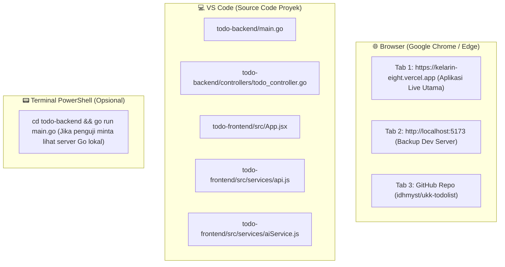
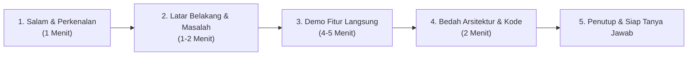

# 🎓 Panduan Sidang & Presentasi UKK PPLG: Proyek "Kelarin"

Dokumen ini disusun khusus sebagai **panduan praktis, contekan visual, dan skrip bicara** untuk menghadapi penguji pada sidang Uji Kompetensi Keahlian (UKK) PPLG.

---

## 🖥️ BAGIAN 1: Checklist Persiapan Layar (Buka Ini Sebelum Maju)

Sebelum dipanggil atau sebelum mulai berbicara, siapkan jendela laptop Anda seperti ini agar saat presentasi Anda tidak panik mencari-cari file:

> [!TIP]
> **Rekomendasi Utama**: Presentasikan langsung dari link cloud Vercel (`https://kelarin-eight.vercel.app`). Ini membuktikan kepada guru penguji bahwa aplikasi Anda bukan sekadar tugas lokal di laptop, melainkan **sudah production-ready dan bisa diakses oleh siapa pun di internet**!

---

## ⏱️ BAGIAN 2: Alur Presentasi Step-by-Step (Total 7–10 Menit)

Berikut urutan bicara dari awal sampai penutup yang terstruktur dan terlihat sangat percaya diri:

---

### 1. Pembukaan (00:00 – 01:00)
*Tatap penguji dengan ramah dan percaya diri.*

> **Skrip Bicara:**
> *"Selamat pagi / siang Bapak/Ibu guru penguji. Perkenalkan nama saya **[Nama Anda]** dari kelas **[Kelas Anda]**, kompetensi keahlian Pengembangan Perangkat Lunak dan Gim (PPLG).*
>
> *Pada kesempatan UKK hari ini, saya bangga mempersembahkan proyek tugas akhir saya yang bernama **Kelarin** — sebuah aplikasi manajemen tugas (Smart To-Do List) berbasis fullstack modern dengan asisten cerdas ganda berbasis AI dan sistem cloud terintegrasi."*

---

### 2. Latar Belakang & Masalah (01:00 – 02:30)
*Jelaskan kenapa Anda membuat aplikasi ini, bukan sekadar to-do list biasa.*

> **Skrip Bicara:**
> *"Bapak/Ibu, to-do list konvensional biasanya hanya berupa catatan statis. Pengguna sering kali malas mengisi formulir yang panjang, sering terlewat deadline karena tidak ada pengingat suara, dan jika laptop mati maka server ikut mati.*
>
> *Untuk menyelesaikan permasalahan tersebut, **Kelarin** hadir dengan 4 nilai tambah utama:*
> 1. * **Natural Language Processing (NLP)**: Pengguna cukup mengetik dalam bahasa Indonesia sehari-hari, AI otomatis menjadwalkan tugas.
> 2. * **Audio Ringtone & Browser Notification**: Peringatan suara aktif saat batas waktu tugas tiba.
> 3. * **Validasi Anti-Tanggal Lampau**: Pengguna dicegah memasukkan deadline yang sudah lewat.
> 4. * **Dual-Engine Architecture**: Berjalan di cloud Vercel & Neon PostgreSQL secara serverless gratis, serta memiliki server Golang Gin untuk kebutuhan komputasi lokal."*

---

### 3. Demo Fitur Langsung (02:30 – 07:00) — *Paling Krusial!*
*Pindahkan tampilan proyektor/layar ke browser `https://kelarin-eight.vercel.app`.*

#### 🎯 Demo 1: CRUD Manual & Proteksi Validasi
1. **Tambah Tugas Manual**:
   - Ketik: *"Belajar Presentasi UKK"*.
   - Pilih Prioritas: **Tinggi (High)**.
   - Pilih Tanggal & Jam (misal hari ini jam 23:00).
   - Klik **Tambah Tugas**. Tunjukkan animasi dan toast berhasil muncul.
2. **Uji Validasi Anti-Tanggal Lampau**:
   - Coba masukkan tanggal kemarin.
   - Tunjukkan bahwa sistem **menolak** dan menampilkan pesan validasi merah: *"Tenggat waktu tidak boleh tanggal atau jam yang sudah lewat!"*.
   - *Katakan ke penguji: "Ini adalah bentuk defensive programming untuk menjaga integritas data."*

#### 🎯 Demo 2: Fitur Bintang — Kelarin AI Assistant (Groq LPU)
1. Tunjukkan panel kanan **Kelarin AI**.
2. Tunjukkan badge **● Online** dan kecepatan **⚡ Groq LPU (< 1 detik)**.
3. Ketikkan perintah bahasa alami di input chat:
   > *"Besok jam 9 pagi presentasi UKK di hadapan guru penguji, tolong set prioritas high dan ingatkan 30 menit sebelumnya"*
4. Kirim! Tunjukkan bagaimana animasi *bouncing dots* ("Sedang mengetik...") muncul di header dan bubble chat.
5. Dalam waktu < 1 detik, kartu tugas rekomendasi muncul lengkap dengan badge prioritas dan tanggal yang dihitung otomatis.
6. Klik tombol **"+ Tambah Tugas"** pada kartu rekomendasi AI tersebut. Tugas seketika masuk ke daftar to-do list!

#### 🎯 Demo 3: Kalender & Jadwal Interaktif
1. Klik tab **"Kalender & Jadwal"**.
2. Tunjukkan kalender visual: tanggal-tanggal yang memiliki tugas ditandai dengan titik warna prioritas (*merah, kuning, biru*).
3. Klik salah satu tanggal untuk melihat rincian agenda di tanggal tersebut.

#### 🎯 Demo 4: Filter, Live Search, & Audio Alert
1. Kembali ke tab **Daftar Tugas**.
2. Ketik di kolom search untuk live filter nama tugas.
3. Klik tombol nada dering di formulir untuk mendemokan suara melodi pengingat deadline.
4. Klik checklist salah satu tugas hingga tercoret (selesai), lalu tunjukkan bagian accordion **"Tugas Selesai"**.

---

### 4. Bedah Arsitektur & Kodingan di VS Code (07:00 – 09:00)
*Beralih ke VS Code untuk memperlihatkan kualitas kode Anda.*

1. **Buka [main.go](file:///d:/TELKOM/ukk-todolist/todo-backend/main.go)**:
   - Tunjukkan penggunaan **Gin Framework**, routing REST API yang teratur (`GET /api/todos`, `POST /api/todos`, `PUT /api/todos/:id`, `DELETE /api/todos/:id`).
   - Tunjukkan konfigurasi CORS dinamis (`AllowOriginFunc`) yang mendukung localhost dan jaringan IP HP.
2. **Buka [todo_controller.go](file:///d:/TELKOM/ukk-todolist/todo-backend/controllers/todo_controller.go)**:
   - Tunjukkan penggunaan **GORM** untuk query PostgreSQL yang aman dari SQL Injection.
3. **Buka [api.js](file:///d:/TELKOM/ukk-todolist/todo-frontend/src/services/api.js)**:
   - Tunjukkan fitur **Smart Failover**: Jika backend lokal Go tidak menyala, frontend secara otomatis dan senyap mengalihkan koneksi ke serverless cloud Vercel & Neon DB.
4. **Buka [aiService.js](file:///d:/TELKOM/ukk-todolist/todo-frontend/src/services/aiService.js)**:
   - Tunjukkan integrasi API Groq LPU dan Gemini dengan penanganan prompt system bahasa alami.

---

### 5. Penutup (09:00 – 10:00)

> **Skrip Bicara:**
> *"Demikian presentasi dari proyek To-Do List **Kelarin**. Aplikasi ini telah memenuhi seluruh kriteria UKK PPLG mulai dari arsitektur decoupled frontend-backend, standar REST API, pengelolaan database PostgreSQL, hingga integrasi kecerdasan buatan dan deployment cloud.*
>
> *Terima kasih atas perhatian Bapak/Ibu guru penguji. Saya siap menerima masukan, saran, maupun pertanyaan dari Bapak/Ibu sekalian."*

---

## 🛡️ BAGIAN 3: Contekan Jawaban Pertanyaan Penguji (Q&A Defense)

| Pertanyaan Penguji | Kunci Jawaban Singkat & Tegas |
| :--- | :--- |
| **"Kenapa pakai Golang untuk backend lokalnya?"** | *"Golang dikompilasi langsung ke kode mesin (*binary*), memiliki konsumsi memori yang sangat hemat (~15MB), dan memiliki konkurensi bawaan (Goroutine) yang sangat cepat dibandingkan runtime berbasis interpreter."* |
| **"Bagaimana cara mencegah SQL Injection?"** | *"Saya menggunakan ORM (GORM di backend Go, dan parameterized query `$1, $2` di Serverless Node.js). Parameter input selalu di-*sanitize* dan dipisahkan dari struktur SQL, sehingga aman dari injeksi perintah berbahaya."* |
| **"Kenapa pakai Neon PostgreSQL, bukan MySQL lokal di XAMPP/Laragon?"** | *"Neon adalah PostgreSQL Serverless berbasis cloud di AWS. Keunggulannya: database online 24 jam tanpa bayar (*free-tier*), mendukung connection pooling, dan membuat aplikasi saya bisa diakses dari mana saja tanpa ketergantungan pada laptop."* |
| **"Apa bedanya Groq LPU dengan Gemini di AI Assistant?"** | *"Groq menggunakan prosesor khusus LPU (Language Processing Unit) yang dirancang untuk kecepatan inferensi ekstrem (< 1 detik). Sedangkan Gemini DeepMind digunakan sebagai mesin cadangan yang kaya pemahaman konteks."* |
| **"Kalau internet mati, apakah backend lokal masih jalan?"** | *"Backend lokal Golang tetap dapat berjalan mandiri di port 8080. Selain itu, frontend memiliki fitur failover otomatis yang cerdas mendeteksi endpoint yang aktif."* |

---

> [!NOTE]
> Simpan atau cetak contekan ini. Kunci utama kelulusan UKK dengan nilai maksimal adalah **ketenangan, kejujuran kode, dan kemampuan mendemokan fitur dengan lancar**. Semoga sukses di hari sidang! 🌟
