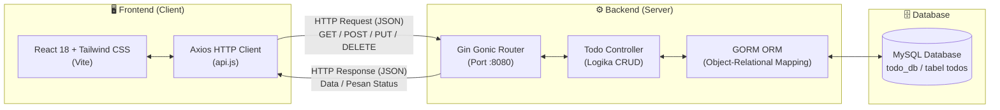

# 📘 Dokumentasi Lengkap Proyek UKK PPLG: Kelarin (To-Do List Fullstack)

Selamat datang di dokumentasi resmi aplikasi **Kelarin**! Dokumen ini disusun secara terstruktur, mendalam, dan komprehensif sebagai panduan teknis sekaligus **bahan belajar mandiri** untuk persiapan presentasi serta pengujian di hadapan guru penguji **Uji Kompetensi Keahlian (UKK) Program Keahlian Pengembangan Perangkat Lunak dan GIM (PPLG)**.

---

## 📑 Daftar Isi
1. [Tentang Proyek "Kelarin"](#1-tentang-proyek-kelarin)
2. [Arsitektur Sistem (Client-Server RESTful API)](#2-arsitektur-sistem-client-server-restful-api)
3. [Teknologi & Bahasa Pemrograman yang Digunakan](#3-teknologi--bahasa-pemrograman-yang-digunakan)
4. [Bedah Mendalam Backend Golang (Gin + GORM + MySQL)](#4-bedah-mendalam-backend-golang-gin--gorm--mysql)
5. [Spesifikasi & Kontrak Endpoint REST API](#5-spesifikasi--kontrak-endpoint-rest-api)
6. [Bedah Mendalam Frontend React Vite](#6-bedah-mendalam-frontend-react-vite)
7. [Fitur-Fitur Utama & Keunggulan UX](#7-fitur-fitur-utama--keunggulan-ux)
8. [Panduan Menjalankan Proyek dari Nol](#8-panduan-menjalankan-proyek-dari-nol)
9. [Kisi-Kisi Pertanyaan Penguji UKK & Kunci Jawabannya](#9-kisi-kisi-pertanyaan-penguji-ukk--kunci-jawabannya)

---

## 1. Tentang Proyek "Kelarin"

**Kelarin** adalah aplikasi manajemen tugas (*To-Do List*) modern, elegan, dan berstandar industri yang memisahkan antara *User Interface* (Frontend) dan logika bisnis/database (Backend) secara independen melalui protokol **REST API**.

Nama **"Kelarin"** diambil dari kata serapan bahasa Indonesia yang berarti *"menyelesaikan"* — mencerminkan tujuan aplikasi ini, yaitu membantu pengguna mencatat, memprioritaskan, dan menyelesaikan seluruh target kegiatan dengan efisien.

* **URL Live Deployment (Vercel)**: [https://kelarin-eight.vercel.app/](https://kelarin-eight.vercel.app/)
* **Local Frontend Server**: `http://localhost:5173/`
* **Local Backend Server**: `http://localhost:8080/`

---

## 2. Arsitektur Sistem (Client-Server RESTful API)

Aplikasi ini menerapkan arsitektur **Decoupled Client-Server (Terpisah)**:



### Bagaimana Alur Komunikasinya?
1. **Pengguna berinteraksi** dengan UI React (misal: mencentang tugas selesai).
2. **Frontend** mengirimkan HTTP Request (berupa data JSON) menggunakan **Axios** ke URL Backend `http://localhost:8080/api/todos/:id`.
3. **Backend Golang (Gin Engine)** menerima request, memvalidasi data masukan, dan mengeksekusinya ke database MySQL melalui **GORM ORM**.
4. **MySQL** menyimpan perubahan, lalu GORM mengembalikan struct data terbaru ke controller.
5. **Gin Controller** membalas ke Frontend dengan **HTTP Response JSON** (status code `200 OK`).
6. **Frontend** memperbarui tampilan secara dinamis tanpa perlu me-reload seluruh halaman browser (*Single Page Application*).

---

## 3. Teknologi & Bahasa Pemrograman yang Digunakan

| Layer | Komponen / Library | Bahasa / Versi | Fungsi & Alasan Pemilihan |
| :--- | :--- | :--- | :--- |
| **Backend** | **Golang** | Go 1.20+ / 1.25+ | Bahasa pemrograman terkompilasi (*compiled language*) buatan Google yang sangat cepat, efisien dalam penggunaan memori, dan andal dalam menangani request konkuren (*concurrency*). |
| **Backend** | **Gin Gonic** | Framework Go v1.10+ | Framework web tercepat di Golang yang menggunakan HTTPRouter radikal. Dilengkapi fitur routing modular, middleware CORS, error recovery, dan binding JSON otomatis. |
| **Backend** | **GORM** | ORM Go v1.25+ | *Object-Relational Mapping* untuk memetakan struct Go langsung ke tabel MySQL. Mempermudah query tanpa perlu menulis query SQL mentah (*raw SQL*) secara manual. |
| **Database** | **MySQL (Laragon)** | MySQL 8.0+ / 5.7+ | Database relasional (RDBMS) standar industri yang stabil, mendukung integritas relasi data dan transaksi ACID. |
| **Frontend** | **React.js** | React 18 (JSX/ES6+) | Library UI berbasis komponen terkemuka di dunia. Menerapkan Virtual DOM untuk rendering tampilan yang cepat dan reaktif menggunakan Hooks (`useState`, `useEffect`, `useMemo`). |
| **Frontend** | **Vite** | Build Tool v5+ | Perkakas build modern generasi baru pengganti Webpack/CRA. Memiliki server dev instan (*Hot Module Replacement*) dan kompilasi produksi yang sangat ringan. |
| **Frontend** | **Tailwind CSS** | CSS Framework v3+ | Framework CSS berbasis *utility-first* yang memungkinkan styling modern, estetik, dan responsif langsung di file JSX tanpa menulis file CSS terpisah yang menumpuk. |
| **Frontend** | **Axios** | HTTP Client | Library pengelola komunikasi API berbasis *Promise* yang otomatis menangani serialisasi data JSON, batas waktu request (*timeout*), dan standardisasi pesan error. |
| **Frontend** | **Lucide React** | Icon Pack | Kumpulan ikon grafis vektor SVG modern yang konsisten dan ringan untuk meningkatkan kejelasan visual antarmuka. |

---

## 4. Bedah Mendalam Backend Golang (Gin + GORM + MySQL)

Struktur file backend di folder `todo-backend/`:
```text
todo-backend/
├── config/
│   └── database.go          # Inisialisasi koneksi MySQL Laragon & Auto-Migration
├── controllers/
│   └── todo_controller.go   # Handler logika CRUD (GetTodos, CreateTodo, UpdateTodo, DeleteTodo)
├── models/
│   └── todo.go              # Model struct Todo & DTO validasi request JSON
├── go.mod                   # Deklarasi modul & dependensi Go
├── go.sum                   # Checksum penguncian versi dependensi
└── main.go                  # Entrypoint: setup Gin, CORS, Routing, dan Server Runner (:8080)
```

### A. Skema Model & Tabel Database (`models/todo.go`)
Data todo dipetakan ke tabel MySQL `todos`:

```go
type Todo struct {
    ID          uint      `gorm:"primaryKey;autoIncrement" json:"id"`
    Title       string    `gorm:"type:varchar(255);not null" json:"title" binding:"required"`
    Priority    string    `gorm:"type:varchar(10);default:'medium'" json:"priority"`
    IsCompleted bool      `gorm:"default:false" json:"is_completed"`
    DueDate     string    `gorm:"type:varchar(50)" json:"due_date"`
    CreatedAt   time.Time `json:"created_at"`
    UpdatedAt   time.Time `json:"updated_at"`
}
```

* **`gorm:"..."`**: Anotasi khusus GORM untuk menentukan tipe kolom MySQL, primary key, dan auto-increment.
* **`json:"..."`**: Anotasi serializer untuk menentukan nama key saat data dikonversi ke format JSON.
* **`binding:"required"`**: Validasi bawaan Gin yang otomatis menolak request jika field tersebut kosong.

#### Struktur Input Update dengan Pointer:
```go
type UpdateTodoInput struct {
    Title       *string `json:"title"`
    Priority    *string `json:"priority"`
    IsCompleted *bool   `json:"is_completed"`
    DueDate     *string `json:"due_date"`
}
```
> **Kenapa Menggunakan Pointer (`*string`, `*bool`)?**  
> Di Golang, tipe data `bool` memiliki nilai default (*zero value*) berupa `false`. Jika tidak menggunakan pointer, saat kita hanya ingin mengupdate judul, nilai `is_completed` yang tidak dikirim di JSON akan otomatis terbaca `false` dan menimpa status tugas! Dengan pointer, jika field tidak dikirim di JSON, nilainya adalah `nil` (kosong), sehingga controller tahu field mana saja yang benar-benar ingin diubah.

---

### B. Konfigurasi Database & Auto Migration (`config/database.go`)
1. **Auto-Create Database**: Kode di fungsi `ConnectDB()` secara cerdas terhubung ke MySQL terlebih dahulu dan mengeksekusi `CREATE DATABASE IF NOT EXISTS todo_db`, sehingga pengguna/penguji tidak perlu membuat database secara manual di phpMyAdmin/HeidiSQL.
2. **Auto-Migrate**: Perintah `db.AutoMigrate(&models.Todo{})` membaca struct Go dan otomatis membuat tabel `todos` beserta kolom-kolomnya jika tabel belum tersedia.

---

### C. Keamanan CORS Middleware (`main.go`)
Karena frontend (`http://localhost:5173` atau `https://kelarin-eight.vercel.app`) berjalan di domain/port yang berbeda dari backend (`http://localhost:8080`), browser akan memblokir request demi keamanan jika tidak ada konfigurasi **CORS (Cross-Origin Resource Sharing)**.

Di file `main.go`, middleware CORS telah dikonfigurasi:
```go
r.Use(cors.New(cors.Config{
    AllowOrigins: []string{
        "http://localhost:5173",
        "http://localhost:5174",
        "https://kelarin-eight.vercel.app", // Domain Vercel live
    },
    AllowMethods: []string{"GET", "POST", "PUT", "DELETE", "OPTIONS"},
    AllowHeaders: []string{"Origin", "Content-Type", "Accept"},
    AllowCredentials: true,
}))
```

---

## 5. Spesifikasi & Kontrak Endpoint REST API

Base URL Backend: **`http://localhost:8080/api`**

### 1. `GET /api/todos` — Ambil Seluruh Data Tugas
* **Tujuan**: Mengambil daftar to-do yang tersimpan di database, diurutkan dari ID terbesar (tugas terbaru di atas).
* **HTTP Status Code**: `200 OK`
* **Response Body (JSON)**:
```json
{
  "data": [
    {
      "id": 1,
      "title": "Selesaikan modul 4 UKK PPLG",
      "priority": "high",
      "is_completed": false,
      "due_date": "2026-11-20",
      "created_at": "2026-11-10T10:00:00Z",
      "updated_at": "2026-11-10T10:00:00Z"
    }
  ]
}
```

---

### 2. `POST /api/todos` — Tambah Tugas Baru
* **Tujuan**: Menyimpan satu tugas baru ke tabel `todos`.
* **Request Header**: `Content-Type: application/json`
* **Request Payload (JSON)**:
```json
{
  "title": "Mengerjakan Laporan UKK",
  "priority": "medium",
  "due_date": "2026-11-25"
}
```
* **HTTP Status Code**: `201 Created`
* **Response Body (JSON)**:
```json
{
  "data": {
    "id": 2,
    "title": "Mengerjakan Laporan UKK",
    "priority": "medium",
    "is_completed": false,
    "due_date": "2026-11-25",
    "created_at": "2026-11-10T10:05:00Z",
    "updated_at": "2026-11-10T10:05:00Z"
  }
}
```

---

### 3. `PUT /api/todos/:id` — Update Tugas / Toggle Selesai
* **Tujuan**: Mengubah status selesai (`is_completed`), judul, prioritas, atau deadline tugas berdasarkan parameter ID.
* **Request Payload Contoh 1 (Hanya toggle status selesai)**:
```json
{
  "is_completed": true
}
```
* **Request Payload Contoh 2 (Edit data tugas)**:
```json
{
  "title": "Mengerjakan Laporan UKK (Revisi)",
  "priority": "high",
  "due_date": "2026-11-28"
}
```
* **HTTP Status Code**: `200 OK`
* **Response Body (JSON)**: Mengembalikan object tugas yang telah diperbarui.

---

### 4. `DELETE /api/todos/:id` — Hapus Tugas
* **Tujuan**: Menghapus baris tugas secara permanen dari database berdasarkan parameter ID.
* **HTTP Status Code**: `200 OK`
* **Response Body (JSON)**:
```json
{
  "message": "To-do berhasil dihapus"
}
```

---

## 6. Bedah Mendalam Frontend React Vite

Struktur komponen di `todo-frontend/src/`:
```text
todo-frontend/src/
├── components/
│   ├── Navbar.jsx          # Header minimalis dengan branding "Kelarin." & tombol refresh
│   ├── TodoForm.jsx        # Formulir input tugas: Judul, Prioritas, Deadline, dan Submit
│   ├── FilterBar.jsx       # Search bar real-time, Tab filter fleksibel, Selector Urutan, & Counter sisa tugas
│   ├── TodoItem.jsx        # Kartu item to-do: Checkbox, badge prioritas, badge deadline pintar, edit & hapus
│   ├── EditModal.jsx       # Modal popup untuk mengubah rincian tugas
│   ├── LoadingSkeleton.jsx # Shimmer animasi placeholder saat pertama kali memuat data
│   ├── EmptyState.jsx      # Tampilan visual informatif jika daftar tugas masih kosong
│   └── ErrorAlert.jsx      # Banner interaktif jika backend Golang belum dinyalakan di port 8080
├── services/
│   └── api.js              # Instance Axios terpusat untuk komunikasi ke REST API Golang
├── utils/
│   └── todoHelpers.js      # Algoritma Smart Urgency Sorting & kalkulasi kedekatan deadline
├── App.jsx                 # Komponen utama (State management, Optimistic UI, & Toast)
├── index.css               # Setup Tailwind CSS, custom scrollbar, dan perlindungan responsif
└── main.jsx                # Entrypoint ReactDOM untuk mounting ke #root
```

### A. Modul Service API (`src/services/api.js`)
Seluruh fungsi panggilan API diisolasi ke dalam modul terpisah agar kode komponen tidak berantakan:
* **Base URL Dinamis**: Menggunakan `import.meta.env.VITE_API_URL || 'http://localhost:8080/api'`. Di laptop lokal akan otomatis memanggil port `8080`, sedangkan di Vercel dapat diarahkan via Environment Variable.
* **Timeout 8 Detik**: Mencegah aplikasi macet jika server mengalami *hang*.
* **Standardisasi Error**: Menerjemahkan galat teknis browser (*misal: `ERR_NETWORK`*) menjadi kalimat bahasa Indonesia yang ramah (*"Tidak dapat terhubung ke server backend Golang..."*).

---

### B. State Management & Optimistic UI Update (`src/App.jsx`)
Aplikasi mengadopsi teknik modern **Optimistic UI Update**:

```javascript
// Cuplikan alur Optimistic UI di App.jsx
const handleToggleStatus = async (id, nextStatus) => {
  const previousTodos = [...todos]; // 1. Simpan cadangan data sebelumnya
  
  // 2. Ubah tampilan di layar secara INSTAN (tanpa menunggu respon server)
  setTodos((prev) =>
    prev.map((t) => (t.id === id ? { ...t, is_completed: nextStatus } : t))
  );

  try {
    // 3. Kirim request ke backend di latar belakang
    const updated = await updateTodo(id, { is_completed: nextStatus });
    setTodos((prev) => prev.map((t) => (t.id === id ? updated : t)));
  } catch (err) {
    // 4. Jika server gagal/mati, batalkan perubahan (Rollback)!
    setTodos(previousTodos);
    showToast('Gagal mengubah status tugas', 'error');
  }
};
```
> **Keunggulan untuk Nilai UKK**: Interaksi pengguna terasa sangat instan dan mulus (*zero-latency*), namun tetap aman karena data otomatis dikembalikan (*rollback*) apabila koneksi terputus.

---

## 7. Fitur-Fitur Utama & Keunggulan UX

1. **Desain Bersih & Elegan ("Kelarin.")**:
   * Header modern tanpa elemen pengganggu.
   * Kontras visual tajam: teks gelap berbobot tebal (`font-bold text-slate-900`) di atas latar bersih.
2. **Formulir Tambah Tugas Lengkap**:
   * Validasi anti-spasi kosong.
   * Pilihan tingkat urgensi/prioritas:
     * 🟢 **Low** (Santai - Hijau)
     * 🟡 **Medium** (Standar - Kuning)
     * 🔴 **High** (Mendesak - Merah)
   * Tanggal deadline opsional (*Due Date*).
   * Tombol submit dengan animasi spinner loading bawaan.
3. **Pencarian Real-Time & Tab Filter**:
   * Kolom pencarian instan berdasarkan judul tugas.
   * Tab filter status: **Semua**, **Belum Selesai (Pending)**, dan **Selesai**.
   * Counter sisa tugas yang dinamis (*"X tugas belum selesai"*).
4. **Item Tugas Interaktif**:
   * Custom checkbox berukuran besar (`w-6 h-6`). Saat selesai, judul otomatis dicoret (*strikethrough*) dan memudar.
   * Tombol aksi yang jelas: Tombol **Edit** (warna ungu) dan tombol **Hapus** (warna merah) dengan konfirmasi singkat pencegah klik tidak sengaja.
5. **Sistem Pengurutan Cerdas & Deteksi Urgensi Deadline (Smart Urgency Sorting)**:
   * **Hierarki Urgensi Otomatis**: Tugas dengan prioritas **High** yang memiliki deadline terdekat otomatis menempati urutan paling atas agar langsung ternotis pengguna (*"biar cepat ke-mention"*). Diikuti oleh prioritas **Medium** lalu **Low**.
   * **Indikator Status Deadline Visual**:
     * ⚠️ **Terlewat (Overdue)**: Badge merah berkedip (*animate-pulse*) jika tanggal deadline telah lampau.
     * 🔥 **Hari Ini!**: Badge oranye menyala jika deadline jatuh pada hari ini.
     * ⚡ **Besok**: Badge amber untuk tugas yang harus selesai besok.
     * ⏳ **X Hari Lagi**: Badge biru indigo untuk deadline mendekat (2-3 hari ke depan).
   * **Aksen Garis Kiri (Left Border Accent)**: Setiap kartu tugas memiliki garis warna vertikal di sisi kiri (`border-l-4`) sesuai level prioritas (Merah untuk High, Kuning untuk Medium, Hijau untuk Low).
   * **Dropdown Pilihan Urutan**: Pengguna dapat memilih 4 mode pengurutan dinamis (*⚡ Urgensi & Deadline, 📅 Deadline Terdekat, 🔥 Prioritas Tertinggi, 🕒 Terbaru Dibuat*).
6. **100% Responsif di Semua Ukuran Layar**:
   * Di layar desktop: card membentang proporsional dan nyaman dibaca (`max-w-5xl`).
   * Di layar tablet/ponsel sempit: form dan tombol otomatis menata diri (*stacking* vertikal), serta tab filter otomatis membungkus diri (*flex-wrap*) tanpa ada konten yang terpotong ke kanan (*zero horizontal scrollbar*).

---

## 8. Panduan Menjalankan Proyek dari Nol

### Prasyarat:
* **Laragon** (atau XAMPP) dengan modul MySQL aktif di port `3306`.
* **Golang** versi 1.20 atau yang lebih baru terpasang di sistem.
* **Node.js** (versi 18+) dan NPM terpasang di sistem.

---

### Langkah 1: Jalankan Database MySQL
1. Buka aplikasi **Laragon**.
2. Klik tombol **Start All** (pastikan Apache & MySQL berstatus *Running*).

---

### Langkah 2: Jalankan Server Backend Golang (Terminal 1)
Buka terminal PowerShell baru, lalu ketik perintah berikut:
```powershell
cd d:\TELKOM\ukk-todolist\todo-backend
go run main.go
```
*Output yang menandakan backend berhasil berjalan:*
```text
🔄 Menjalankan Auto Migration...
✅ Koneksi database MySQL Laragon berhasil & skema tabel siap digunakan!
🚀 Server To-Do REST API berjalan di http://localhost:8080
```

---

### Langkah 3: Jalankan Frontend React (Terminal 2)
Buka tab/jendela terminal PowerShell baru, lalu ketik perintah berikut:
```powershell
cd d:\TELKOM\ukk-todolist\todo-frontend
npm install
npm run dev
```
*Output yang menandakan frontend berhasil berjalan:*
```text
  VITE v5.4.21  ready in 400 ms

  ➜  Local:   http://localhost:5173/
```

Buka peramban (browser Google Chrome / Edge) dan buka alamat:  
👉 **`http://localhost:5173/`**  
*(Aplikasi siap diuji dan digunakan!)*

---

## 9. Kisi-Kisi Pertanyaan Penguji UKK & Kunci Jawabannya

Gunakan bagian ini untuk melatih mental dan memperkuat pemahaman sebelum presentasi di hadapan guru penguji:

### Q1: "Jelaskan apa itu REST API dan bagaimana cara kerjanya di aplikasi kamu?"
> **Jawaban:**  
> *"REST API (Representational State Transfer Application Programming Interface) adalah standar arsitektur komunikasi data berbasis protokol HTTP. Di aplikasi Kelarin, backend Golang bertindak sebagai penyedia data (Server), sedangkan frontend React bertindak sebagai konsumen (Client).*  
> *Komunikasi dilakukan melalui 4 metode standar HTTP:*  
> 1. *`GET` untuk membaca data tugas dari database.*  
> 2. *`POST` untuk mengirim data tugas baru.*  
> 3. *`PUT` untuk memperbarui status atau isi tugas.*  
> 4. *`DELETE` untuk menghapus tugas berdasarkan ID.*  
> *Pertukaran datanya menggunakan format standar JSON (JavaScript Object Notation)."*

---

### Q2: "Mengapa kamu memilih Golang dan Gin untuk backend, bukan bahasa lain seperti PHP atau Node.js?"
> **Jawaban:**  
> *"Golang adalah bahasa pemrograman terkompilasi (compiled language) buatan Google. Berbeda dengan bahasa interpreted, Golang langsung dikompilasi menjadi kode biner mesin sehingga memiliki performa eksekusi yang luar biasa cepat dan penggunaan memori yang sangat hemat.*  
> *Framework Gin dipilih karena merupakan salah satu web framework tercepat di ekosistem Go, memiliki router cerdas berbasis radikal tree, serta menyediakan middleware CORS dan validasi data terintegrasi."*

---

### Q3: "Apa fungsi GORM di backend kamu?"
> **Jawaban:**  
> *"GORM adalah library ORM (Object-Relational Mapping) untuk Golang. Fungsinya adalah menjembatani struct kode Go dengan tabel database relasional MySQL. Dengan GORM, saya tidak perlu menulis query SQL mentah secara manual, terhindar dari bahaya celah SQL Injection berkat prepared statements otomatis, serta bisa memanfaatkan fitur AutoMigrate untuk membuat dan memperbarui skema tabel secara otomatis saat aplikasi dimulai."*

---

### Q4: "Mengapa kamu menggunakan React dengan Vite, bukan React biasa (Create React App)?"
> **Jawaban:**  
> *"Create React App (CRA) sudah resmi dinyatakan usang (deprecated) oleh tim pengembang React. Vite adalah build tool modern generasi baru yang menggunakan Native ES Modules (ESM). Vite menawarkan kecepatan server pengembang (Hot Module Replacement / HMR) yang instan, serta ukuran bundle produksi yang jauh lebih kecil dan cepat berkat bundler Rollup."*

---

### Q5: "Apa itu CORS dan mengapa kamu harus mengaturnya di backend?"
> **Jawaban:**  
> *"CORS (Cross-Origin Resource Sharing) adalah mekanisme keamanan pada peramban web modern yang melarang halaman web melakukan request ke domain atau port yang berbeda dari asalnya demi mencegah serangan peretasan (Cross-Site Scripting).*  
> *Karena frontend React berjalan di `http://localhost:5173` (dan di Vercel), sedangkan backend Golang di `http://localhost:8080`, browser secara bawaan akan memblokir request. Oleh karena itu, di file `main.go`, saya memasang middleware CORS untuk mengizinkan (whitelist) origin frontend mengakses endpoint API."*

---

### Q6: "Bagaimana aplikasi kamu menangani situasi jika backend mati atau database belum dinyalakan?"
> **Jawaban:**  
> *"Di frontend, modul `api.js` mendeteksi galat koneksi jaringan (`ERR_NETWORK`). Jika backend offline, aplikasi tidak akan crash atau blank putih, melainkan menampilkan komponen `ErrorAlert.jsx` yang elegan. Komponen ini menjelaskan bahwa backend belum aktif, memberikan panduan perintah terminal `go run main.go`, dan menyediakan tombol 'Coba Lagi' untuk menyambungkan kembali tanpa perlu merefresh halaman."*

---

### Q7: "Apa yang dimaksud dengan Optimistic UI Update yang kamu terapkan di checkbox tugas?"
> **Jawaban:**  
> *"Optimistic UI adalah pola interaksi di mana antarmuka pengguna diperbarui seketika saat tombol atau checkbox diklik (tugas langsung tercoret hijau), seolah-olah request pasti berhasil, tanpa membuat pengguna menunggu respon jaringan. Namun, aplikasi tetap menyimpan cadangan data lama. Jika ternyata server gagal merespons, aplikasi akan otomatis membatalkan perubahan (rollback) dan memunculkan notifikasi kesalahan."*

---

### Q8: "Bagaimana kamu memastikan aplikasi ini responsif di layar ponsel maupun desktop?"
> **Jawaban:**  
> *"Saya menggunakan Tailwind CSS dengan pendekatan Mobile-First. Semua elemen dasar diatur untuk layar sempit terlebih dahulu, kemudian ditingkatkan pada breakpoint `sm:` (640px) dan `md:` (768px). Selain itu, form dan tab filter menggunakan `flex-wrap` dan `min-w-0`, serta seluruh elemen menerapkan `box-sizing: border-box`, sehingga tidak akan ada elemen yang terpotong ke kanan saat layar ditarik sempit."*

---

*Dokumentasi ini dibuat khusus untuk mendukung kelulusan maksimal pada Uji Kompetensi Keahlian (UKK) Program Keahlian Rekayasa Perangkat Lunak / PPLG SMK.*  
**Selamat belajar dan sukses untuk ujian UKK-nya! 🚀**
